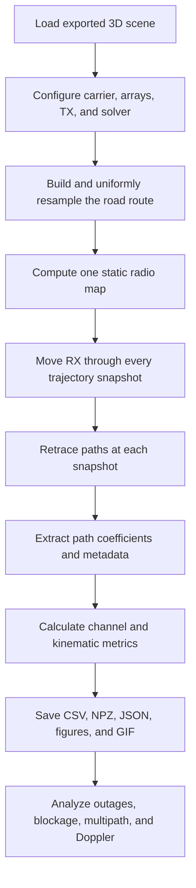

# Sionna RT Mobility Channel Study

This document explains `mobility_channel_study.ipynb`, the exported 3D scene, the propagation model, every generated dataset, and how to interpret the visualizations. It is intended both as a user guide and as technical documentation for presenting or extending the experiment.

The worked example throughout this document is the latest completed run:

`outputs/mobility_20260918_004212`

Older timestamped folders are independent runs. Do not combine their CSV, NPZ, figures, or configuration files with this run.

## Documentation map

- Sections 1–10 explain the scientific model, scene, mobility, propagation, equations, and notebook execution.
- Sections 11–15 define every exported file, CSV field, NPZ array, and JSON metadata group.
- Sections 16–17 explain every static visualization and animation control.
- Sections 18–23 explain connectivity, latest-run results, analysis, reproducibility, limitations, and extensions.
- Section 24 is the hands-on guide for changing the route, scene, devices, RF settings, mechanisms, map, and animation.
- Sections 25–27 provide troubleshooting, a presentation sequence, and official references.

## 1. What the notebook studies

The transmitter is fixed while a receiver follows roads around it. At each receiver position, Sionna RT retraces the propagation paths through the 3D environment. The notebook records:

- receiver position, velocity, acceleration, and orientation;
- line-of-sight and non-line-of-sight connectivity;
- individual propagation paths and their interaction sequences;
- delay, phase, complex amplitude, Doppler shift, departure angles, and arrival angles;
- coherent received power, path loss, SNR, and delay/Doppler spread;
- approximate power grouped by propagation mechanism;
- a static coverage/radio map and an animated moving receiver;
- machine-readable CSV, NPZ, and JSON files for later analysis.

This is a sequence of deterministic ray-tracing snapshots along a trajectory. It is suitable for studying geometry-dependent channel evolution, blockage, reconnection, multipath, delay spread, and Doppler caused by receiver motion.

## 2. Project files

| File or folder | Purpose |
|---|---|
| `mobility_channel_study.ipynb` | Main executable experiment and explanations |
| `test.ipynb` | Earlier scene exploration/reference notebook |
| `test_scene/test_scene.xml` | Mitsuba/Sionna RT scene description |
| `test_scene/meshes/` | Exported geometry used by the scene |
| `outputs/mobility_<timestamp>/` | One immutable experiment result folder |
| `outputs/mobility_20260918_004212/` | Latest run documented here |

## 3. End-to-end workflow



The radio map is computed once because the transmitter and environment are static. Exact paths are recomputed for every receiver snapshot because receiver position, orientation, delay, phase, visibility, and Doppler change with time.

## 4. Running the notebook

1. Open `mobility_channel_study.ipynb` in the Python environment containing Sionna RT and its rendering dependencies.
2. Select a profile in the configuration cell: `quick`, `balanced`, or `publication`.
3. Run all cells from top to bottom.
4. Inspect the printed run directory. Running the configuration cell creates a timestamped folder. Rerunning export/plot/animation cells without rerunning the configuration cell writes into that same folder and can overwrite its files.
5. Start analysis with `RUN_SUMMARY.md`, `run_config.json`, and `snapshot_summary.csv` in that folder.

The latest documented run used Python 3.11.9 and NumPy 2.4.6. The installed Sionna package did not expose a package-level `__version__`, so the run recorded it as `unknown`. For reproducible publication work, record the exact package version separately using the environment's package manager or save a lock file.

### Runtime dependencies

The notebook directly uses:

- Python 3;
- NumPy;
- Matplotlib;
- Sionna RT;
- Mitsuba and Dr.Jit through Sionna RT rendering;
- Pillow for PNG compositing, labels, and GIF creation;
- a Jupyter frontend for notebook execution and the optional interactive preview.

Pillow and Mitsuba are imported only in the animation cell. A numerical run can finish before an unavailable animation dependency is discovered. Test the animation with the `quick` profile before beginning a long render.

### Computation profiles

| Profile | Snapshots | Path depth | Path samples | Radio-map samples/TX | Radio-map cell |
|---|---:|---:|---:|---:|---:|
| `quick` | 21 | 2 | 20,000 | 100,000 | 5 m |
| `balanced` | 61 | 3 | 100,000 | 250,000 | 4 m |
| `publication` | 181 | 5 | 1,000,000 | 1,000,000 | 2 m |

The latest run used `balanced`. Higher settings can reveal weaker or higher-order paths, but they require more computation and memory. They do not automatically make every physical assumption more accurate.

## 5. Physical scenario

### 5.1 Coordinate system

All scene locations are Cartesian coordinates in metres:

- `x`, `y`: horizontal scene axes;
- `z`: height;
- time is in seconds;
- angles saved to CSV are in degrees;
- orientations stored in NPZ are in radians.

Approximate exported mesh bounds are:

- buildings/objects: `[-266.894, -172.454, 0]` to `[252.129, 179.281, 70]` m;
- ground plane: `[-327.780, -222.030, 0]` to `[289.619, 209.590, 0]` m.

These bounds help detect trajectories or cameras placed outside the meaningful scene.

### 5.2 Transmitter

- Position: `[-107, 43, 10]` m
- Orientation: `[0, 0, 0]` rad
- Carrier frequency: 3.5 GHz
- Transmit power: 44 dBm
- Array: 4 x 4 `tr38901` elements
- Polarization: vertical
- Element spacing: half a wavelength
- Excitation: equal amplitude and equal phase, normalized by `1/sqrt(number of TX antennas)`

The normalization keeps the total input power interpretation consistent when coherently combining the array elements.

At 3.5 GHz, the free-space wavelength calculated with `C0 = 299,792,458 m/s` is approximately 0.08565 m, so half-wavelength array spacing is approximately 0.04283 m. The 44 dBm transmitter power is approximately 25.12 W.

### 5.3 Receiver

- Height: 2 m
- Array: 1 x 1 isotropic element
- Polarization: vertical
- Speed parameter: 10 m/s
- Orientation: yaw follows the local direction of motion
- Start/end: `[160, -74, 2]` m

The receiver returns to its starting position. Its orientation can still differ depending on the local travel direction, so repeated coordinates should not automatically be assumed to be identical channel states.

### 5.4 Materials in the exported model

The material audit for the latest run reported:

| Scene object | Object ID in this run | Material | Relative permittivity | Conductivity (S/m) | Thickness (m) | Scattering coefficient | XPD coefficient |
|---|---:|---|---:|---:|---:|---:|---:|
| `elm__4` | 3 | `itu_marble` | 7.074 | 0.01755 | 0.1 | 0 | 0 |
| `elm__5` | 4 | `itu_metal` | 1.0 | 10,000,000 | 0.1 | 0 | 0 |
| `elm__7` | 5 | `itu_concrete` | 5.240 | 0.12309 | 0.1 | 0 | 0 |

Object IDs are runtime identifiers and may change after editing or reloading a scene. Interpret them using the `material_audit` saved in the same `run_config.json`, rather than assuming an ID has a permanent meaning.

The scattering coefficients are zero in this scene. Diffuse scattering may be enabled in the solver, but zero material scattering means it should contribute no diffuse power unless the materials are changed.

## 6. Road-aware receiver trajectory

The route is an out-and-back path with northern and southern/western branches around the transmitter. Its purpose is to create varied visibility and obstruction conditions instead of moving directly toward the transmitter.

The 31 control waypoints are:

```text
[160,-74,2] -> [120,-56,2] -> [80,-39,2] -> [40,-22,2]
-> [0,-4,2] -> [-40,13,2] -> [-70,28,2] -> [-82,55,2]
-> [-120,68,2] -> [-82,55,2] -> [-70,28,2] -> [-40,13,2]
-> [-25,5,2] -> [-25,-40,2] -> [-95,-40,2] -> [-130,-35,2]
-> [-155,-20,2] -> [-160,20,2] -> [-155,-20,2] -> [-130,-35,2]
-> [-95,-40,2] -> [-25,-40,2] -> [-25,5,2] -> [-40,13,2]
-> [-70,28,2] -> [-40,13,2] -> [0,-4,2] -> [40,-22,2]
-> [80,-39,2] -> [120,-56,2] -> [160,-74,2]
```

The notebook calculates cumulative polyline distance and resamples the route at uniformly spaced distances. For the latest run:

- route length: 1183.45 m;
- nominal speed: 10 m/s;
- simulated duration: 118.35 s;
- snapshots: 61;
- approximate distance interval: 19.72 m;
- approximate time interval: 1.97 s.

`distance_m` and `time_s` are based on uniform distance along the **control-waypoint polyline** and the nominal `RX_SPEED_MPS`. The saved positions are samples interpolated at those distances. Consecutive saved positions form straight chords; when an interval straddles a sharp corner or reversal, the chord is shorter than the corresponding waypoint-arc interval. Consequently, finite-difference `speed_mps` is not exactly equal to `RX_SPEED_MPS` near such turns.

Velocity is a forward difference of consecutive saved positions divided by the nominal time interval. The final snapshot reuses the preceding segment velocity. Acceleration is a difference of those velocity samples; the first acceleration is zero. Only the first component of `orientation_rad` is assigned, using `atan2(v_y, v_x)` as the horizontal heading; the other two components remain zero.

For the latest balanced run, the waypoint arc length is 1183.45 m, while the sum of the 60 sampled position-to-position chords is 1120.16 m. Saved speed ranges from 0.6834 to 10.0000 m/s and averages 9.4739 m/s. These reductions occur mainly where a coarse interval crosses a reversal or corner. Doppler uses the saved receiver velocity, so it follows these finite-difference speeds rather than an ideal constant 10 m/s at every snapshot.

Acceleration and orientation are kinematic descriptors, not a vehicle-dynamics model. Increase `num_steps` or use a waypoint-preserving trajectory construction when corner behavior is scientifically important.

## 7. Propagation mechanisms

The latest configuration enables:

- line of sight (LoS);
- specular reflection;
- refraction/transmission;
- diffraction;
- edge diffraction;
- diffraction in lit regions;
- diffuse scattering.

The solver maximum interaction depth is 3 for the balanced profile. A path can therefore contain more than one interaction, such as reflection followed by diffraction.

### Interpretation of mechanisms

- **LoS**: direct unobstructed transmitter-to-receiver path.
- **Specular reflection**: energy reflected from a surface according to the material and geometry.
- **Refraction/transmission**: energy transmitted through a modeled material boundary. In Sionna RT's thin-slab material model, this should not be interpreted as a complete volumetric bent ray through an arbitrarily thick building.
- **Diffraction**: energy bending around eligible wedges or edges; useful for NLoS connection around corners.
- **Diffuse scattering**: non-specular reradiation from rough surfaces. Although enabled, it is effectively suppressed here because the audited material scattering coefficients are zero.
- **Mixed**: a path containing more than one non-LoS interaction type.

The CSV category is an exclusive reporting label. Detailed interaction sequences must be used when the exact ordered path physics matters.

Sionna RT currently limits diffraction to first order: a path can contain at most one diffraction interaction, although it may also contain reflections or refractions. `ENABLE_EDGE_DIFFRACTION` enables diffraction on free-floating edges, but the exported category remains `diffraction`; there is no separate `edge_diffraction` CSV class. A `mixed` path contains more than one **distinct** non-LoS interaction type, such as specular reflection plus diffraction. Two specular reflections without another interaction type remain `specular`.

With `SYNTHETIC_ARRAY=True`, geometric paths are found between virtual devices at the array centers and per-element phase shifts are applied synthetically. This reduces solver cost and relies on the plane-wave approximation for the array response.

## 8. Snapshot ray tracing

For each trajectory sample, the notebook:

1. updates receiver position and direction;
2. invokes the path solver with a fixed seed and deterministic operation;
3. obtains complex channel coefficients with absolute delays (`normalize_delays=False`);
4. combines the TX antenna dimension using normalized equal-phase weights;
5. extracts valid paths, interactions, object IDs, primitive IDs, vertices, delays, Doppler, and angles;
6. calculates path-level and snapshot-level metrics;
7. appends data to the final CSV and NPZ datasets.

Path indices are local to one snapshot. `path_index=5` at two different steps does not prove that it is the same physical ray. To track a path over time, compare its interaction/object sequence, delay, angles, vertices, and continuity—not only the index.

## 9. Channel and power calculations

Let `a[m,i]` be the complex coefficient from transmit antenna `m` for path `i`, and let the normalized TX weight be `w[m]`.

### Per-path effective coefficient

```text
h_i = sum_m w[m] * a[m,i]
```

### Per-path gain and loss

```text
G_i             = |h_i|^2
path_gain_db    = 10 log10(G_i)
path_loss_db    = -path_gain_db
received_power  = P_tx * G_i
```

### Coherent total power

```text
G_coherent = |sum_i h_i|^2
P_coherent = P_tx * G_coherent
```

This includes constructive and destructive phase interference among paths. It is the notebook's reported narrowband RSS.

### Incoherent path-power sum

```text
P_incoherent = P_tx * sum_i |h_i|^2
```

This discards cross-path interference. Comparing coherent and incoherent power helps identify fading caused by phase cancellation or reinforcement.

### Noise and SNR

```text
SNR = P_coherent / P_noise
```

The saved noise power follows the thermal-noise settings associated with the scene bandwidth and temperature. The current calculation does not add an explicit receiver noise figure, cable loss, implementation loss, interference, antenna mismatch, or receiver sensitivity threshold. Therefore, `is_outage` means **no valid traced propagation path**, not “a practical modem cannot decode the signal.” A link-budget outage threshold should be added for a communication-system study.

### Delay statistics

With per-path power weights `p_i = |h_i|^2` and delays `tau_i`:

```text
mean_delay = sum_i(p_i * tau_i) / sum_i(p_i)
rms_delay_spread = sqrt(sum_i(p_i * (tau_i - mean_delay)^2) / sum_i(p_i))
```

Absolute delays are stored. Delay spread describes temporal dispersion and can be related to coherence bandwidth, but that relationship depends on the chosen engineering approximation.

### Doppler statistics

For per-path Doppler `nu_i`:

```text
mean_doppler = sum_i(p_i * nu_i) / sum_i(p_i)
rms_doppler_spread = sqrt(sum_i(p_i * (nu_i - mean_doppler)^2) / sum_i(p_i))
```

Doppler arises from receiver velocity and the arrival/departure geometry. The environment and transmitter are static in this experiment.

### dBm conversion

```text
P_dBm = 10 log10(P_watts / 1 milliwatt)
```

Zero and very small powers are clipped to `EPS = np.finfo(np.float64).tiny` before applying logarithms. Therefore, an empty category or no-path coherent power is stored as an extremely negative finite dBm floor rather than blank/NaN. For 44 dBm transmit power, the category/RSS floor is approximately -3032.53 dBm. Always use the corresponding `<category>_num_paths` or `is_outage` field to identify absence; do not interpret this floor as a measurable signal.

## 10. Notebook sections

The notebook is deliberately linear so it can be rerun from a clean kernel:

1. **Imports and helpers** — numerical, plotting, filesystem, and Sionna RT dependencies.
2. **Experiment configuration** — profile, scene path, carrier, power, speed, mechanisms, map, camera, and animation settings.
3. **Output setup** — timestamped run directory and reproducibility metadata.
4. **Scene and arrays** — loads geometry and attaches TX/RX arrays.
5. **Route generation** — defines waypoints and uniformly samples distance.
6. **Scene audit** — records object/material electromagnetic parameters.
7. **Static radio map** — calculates coverage over the selected rectangular region.
8. **Mobility loop** — moves the RX, retraces paths, and collects data.
9. **Dataset creation** — constructs path and snapshot tables and dense arrays.
10. **Static figures** — coverage, trajectory, channel metrics, mechanism contributions, path geometry, and PDP.
11. **Native scene preview** — interactive Sionna scene view when supported by the frontend.
12. **Transparent animation** — renders scene and radio-map layers and alpha-composites them into a GIF.
13. **Export documentation** — writes the run summary and per-run data dictionary.

If a cell fails, fix the cause and rerun that cell plus every dependent cell below it. For the strongest reproducibility guarantee, restart the kernel and run all cells.

## 11. Output directory anatomy

```text
outputs/mobility_20260918_004212/
|-- RUN_SUMMARY.md
|-- DATA_DICTIONARY.md
|-- run_config.json
|-- snapshot_summary.csv
|-- path_data.csv
|-- channel_arrays.npz
|-- receiver_motion_transparent_radio_map.gif
|-- figures/
|   |-- coverage_and_trajectory.png
|   |-- channel_metrics.png
|   |-- mechanism_contributions.png
|   `-- snapshot_060_paths_and_pdp.png
`-- scene_frames/
    |-- frame_0000.png
    |-- ...
    `-- frame_0030.png
```

`scene_frames` contains 31 frames because animation stride 2 selects every second snapshot from the 61-step run. The latest GIF uses 1000 ms per frame.

Some outputs are conditional:

- `coverage_and_trajectory.png` requires `COMPUTE_RADIO_MAP=True`;
- the GIF and `scene_frames/` require `CREATE_SCENE_GIF=True` and a successful animation cell;
- the snapshot filename reflects `SELECTED_STEP`, so it is not always `snapshot_060_paths_and_pdp.png`.

The raw `RadioMap.path_gain` tensor is **not** saved by the current notebook. It is used in memory to create the coverage figure, preview, and GIF. Save it explicitly to NPZ if later numerical radio-map analysis is required. The serialized CSV/NPZ channel data describes the exact receiver trajectory snapshots, not every radio-map cell.

## 12. `snapshot_summary.csv` data dictionary

There is one row per receiver snapshot.

| Column | Unit | Meaning |
|---|---|---|
| `step` | index | Zero-based trajectory sample |
| `time_s` | s | Nominal waypoint-arc time, `distance_along_route_m / RX_SPEED_MPS` |
| `distance_along_route_m` | m | Cumulative distance on the control-waypoint polyline, not sampled chord total |
| `rx_x_m`, `rx_y_m`, `rx_z_m` | m | Receiver coordinates |
| `speed_mps` | m/s | Magnitude of forward finite-difference velocity; may fall below nominal speed at turns |
| `acceleration_mps2` | m/s² | Magnitude of finite-difference acceleration; first sample is zero |
| `num_paths` | count | Number of valid extracted propagation paths |
| `is_outage` | Boolean | True when no valid ray-traced path was found |
| `has_los` | Boolean | True when at least one direct LoS path exists |
| `coherent_path_gain_linear` | linear | Squared magnitude of coherently summed path coefficient |
| `coherent_path_gain_db` | dB | Coherent channel gain |
| `path_loss_db` | dB | Negative of coherent channel gain in dB |
| `rss_w` | W | Coherent narrowband received power |
| `rss_dbm` | dBm | Coherent narrowband received power |
| `incoherent_rss_w` | W | Sum of individual path powers |
| `incoherent_rss_dbm` | dBm | Incoherent received power |
| `noise_power_w` | W | Thermal noise power used by the experiment |
| `noise_power_dbm` | dBm | Same noise power in dBm |
| `snr_linear` | linear | `rss_w / noise_power_w` |
| `snr_db` | dB | SNR in decibels |
| `mean_delay_s` | s | Power-weighted mean absolute path delay |
| `rms_delay_spread_s` | s | RMS delay spread |
| `rms_delay_spread_ns` | ns | RMS delay spread in nanoseconds |
| `mean_doppler_hz` | Hz | Power-weighted mean path Doppler |
| `rms_doppler_spread_hz` | Hz | Power-weighted RMS Doppler spread |
| `<category>_num_paths` | count | Number of paths in an exclusive mechanism category |
| `<category>_power_dbm` | dBm | Power from the coherent sum of complex paths within that category |

The mechanism prefixes are `los`, `specular`, `refraction`, `diffraction`, `diffuse`, and `mixed`.

The 12 exact mechanism columns are:

| Count column | Power column |
|---|---|
| `los_num_paths` | `los_power_dbm` |
| `specular_num_paths` | `specular_power_dbm` |
| `refraction_num_paths` | `refraction_power_dbm` |
| `diffraction_num_paths` | `diffraction_power_dbm` |
| `diffuse_num_paths` | `diffuse_power_dbm` |
| `mixed_num_paths` | `mixed_power_dbm` |

Edge-diffracted paths are included under `diffraction`; the CSV does not have a separate edge-diffraction column.

Category powers are diagnostic decompositions. Paths are coherently combined within each category, so category values include within-category interference. Their dBm values must not be added directly. Even after conversion to watts, summing categories does not generally reproduce total coherent RSS because cross terms between different categories are absent.

## 13. `path_data.csv` data dictionary

There is one row per valid path per snapshot.

| Column | Unit | Meaning |
|---|---|---|
| `step` | index | Parent snapshot |
| `time_s` | s | Parent snapshot's nominal waypoint-arc time |
| `distance_along_route_m` | m | Parent snapshot's control-polyline arc distance |
| `rx_x_m`, `rx_y_m`, `rx_z_m` | m | Receiver position |
| `rx_vx_mps`, `rx_vy_mps`, `rx_vz_mps` | m/s | Forward finite-difference receiver velocity supplied to Sionna for Doppler |
| `path_index` | local index | Path index within this snapshot only |
| `category` | label | Exclusive `los`, `specular`, `refraction`, `diffraction`, `diffuse`, or `mixed` class |
| `interaction_sequence` | encoded text | Ordered interaction types along the ray |
| `object_sequence` | encoded text | Ordered scene objects touched by the ray |
| `material_sequence` | encoded text | Ordered material names along the ray |
| `primitive_ids_json` | JSON | Mesh primitive/triangle identifiers |
| `vertices_json` | JSON | Propagation vertices in metres |
| `delay_s` | s | Absolute path delay |
| `delay_ns` | ns | Absolute path delay in nanoseconds |
| `delay_distance_m` | m | Delay multiplied by speed of light |
| `geometric_length_m` | m | Length calculated from saved ray vertices/endpoints |
| `doppler_hz` | Hz | Doppler shift of this path |
| `a_real`, `a_imag` | amplitude | Real and imaginary parts of effective complex coefficient `h_i` |
| `amplitude` | amplitude | Magnitude `|h_i|` |
| `phase_rad` | rad | Phase angle of `h_i` |
| `path_gain_linear` | linear | `|h_i|²` |
| `path_gain_db` | dB | `10 log10(|h_i|²)` |
| `path_loss_db` | dB | Negative path gain in dB |
| `received_power_w` | W | `P_tx |h_i|²` |
| `received_power_dbm` | dBm | Per-path received power |
| `aod_zenith_deg`, `aod_azimuth_deg` | deg | Angles of departure |
| `aoa_zenith_deg`, `aoa_azimuth_deg` | deg | Angles of arrival |

`geometric_length_m` and `delay_distance_m` are useful consistency checks but need not be exactly equal under every propagation/material model. JSON fields should be parsed with a JSON parser, not split by punctuation.

`phase_rad` is the principal complex phase returned by `np.angle`, normally in `[-pi, pi]`. A direct LoS row has `interaction_sequence="los"` and normally empty object/material sequences because it has no surface interaction.

## 14. `channel_arrays.npz` data dictionary

The compressed NumPy archive preserves dense arrays that are inconvenient in CSV. Load it with:

```python
import numpy as np

data = np.load(
    "outputs/mobility_20260918_004212/channel_arrays.npz",
    allow_pickle=False,
)
print(data.files)
```

Let:

- `S` = number of snapshots;
- `P` = padded maximum path count;
- `A` = TX antenna count;
- `D` = padded interaction depth.

| Array | Shape | Meaning |
|---|---|---|
| `trajectory_m` | `[S, 3]` | Receiver position |
| `time_s` | `[S]` | Snapshot time |
| `distance_m` | `[S]` | Control-waypoint polyline arc distance |
| `velocity_mps` | `[S, 3]` | Receiver velocity vector |
| `acceleration_mps2` | `[S, 3]` | Receiver acceleration vector |
| `orientation_rad` | `[S, 3]` | Receiver `[alpha,beta,gamma]`; current notebook sets horizontal heading in `alpha` and leaves the other components zero |
| `valid` | `[S, P]` | Valid-path mask; always apply before using padded data |
| `tau_s` | `[S, P]` | Absolute delays |
| `doppler_hz` | `[S, P]` | Per-path Doppler shifts |
| `h_path` | `[S, P]` complex | Effective path coefficient after TX-array combination |
| `a_by_tx_ant` | `[S, A, P]` complex | Coefficient before TX-array combination |
| `interactions` | `[S, D, P]` | Encoded interaction types |
| `object_ids` | `[S, D, P]` | Runtime scene-object identifiers |
| `primitive_ids` | `[S, D, P]` | Mesh primitive identifiers |
| `vertices_m` | `[S, D, P, 3]` | Interaction vertices |
| `theta_t_rad`, `phi_t_rad` | `[S, P]` | Departure zenith/azimuth |
| `theta_r_rad`, `phi_r_rad` | `[S, P]` | Arrival zenith/azimuth |

Invalid padded entries can contain sentinel or non-physical values. Use `valid[snapshot]` before numerical analysis.

For interaction-depth arrays, also use `interactions != InteractionType.NONE` to identify active interaction levels. `object_ids` and `primitive_ids` use the maximum unsigned 32-bit integer as the invalid sentinel, while unused vertices and most floating arrays use NaN. `interactions` uses zero/`NONE` for unused depths.

The latest archive has this concrete schema:

| Array | Latest shape | Stored dtype |
|---|---:|---|
| `trajectory_m` | `[61, 3]` | `float64` |
| `time_s`, `distance_m` | `[61]` | `float64` |
| `velocity_mps`, `acceleration_mps2`, `orientation_rad` | `[61, 3]` | `float64` |
| `valid` | `[61, 128]` | Boolean |
| `tau_s`, `doppler_hz` | `[61, 128]` | `float32` |
| `h_path` | `[61, 128]` | `complex64` |
| `a_by_tx_ant` | `[61, 16, 128]` | `complex64` |
| `interactions`, `object_ids`, `primitive_ids` | `[61, 3, 128]` | `uint32` |
| `vertices_m` | `[61, 3, 128, 3]` | `float32` |
| departure/arrival angle arrays | `[61, 128]` | `float32` |

The padded size `P=128` is the largest solver path-vector length observed among these snapshots, not the number of valid paths at every snapshot. Apply the Boolean mask before calculating statistics.

Example:

```python
s = 20
mask = data["valid"][s]
delays_ns = data["tau_s"][s, mask] * 1e9
path_power = np.abs(data["h_path"][s, mask]) ** 2
doppler = data["doppler_hz"][s, mask]
```

## 15. `run_config.json` metadata

This file is the main provenance record for a run. It stores:

- creation time and run name;
- selected computation profile;
- scene path;
- carrier frequency, bandwidth, TX power, and speed;
- TX/RX positions and the complete waypoint list;
- array and synthetic-array settings;
- enabled propagation mechanisms and solver depth/sample count;
- radio-map region and resolution;
- animation enable flag, camera, transparency, stride, and duration;
- material audit;
- Python, Sionna, and NumPy version information;
- interpretation notes for the power calculation.

### Exact JSON key map

| JSON key | Meaning |
|---|---|
| `run_name` | Timestamp-derived run-directory name |
| `created_local` | Local timestamp when the JSON export cell ran |
| `run_profile` | Selected profile name |
| `profile.num_steps` | Requested number of trajectory snapshots |
| `profile.max_depth` | Maximum path interaction depth |
| `profile.path_samples` | Path-solver samples per source |
| `profile.rm_samples` | Radio-map samples per transmitter |
| `profile.rm_cell_m` | Radio-map cell width and height in metres |
| `scene_path` | Scene XML path supplied to `load_scene` |
| `carrier_frequency_hz` | Scene carrier frequency |
| `bandwidth_hz` | Scene bandwidth used in thermal noise |
| `tx_power_dbm` | Transmitter power |
| `tx_position_m` | Transmitter Cartesian position |
| `rx_start_m`, `rx_end_m` | First and last control waypoints |
| `rx_waypoints_m` | Complete control-waypoint array |
| `trajectory_description` | Human-written route description; currently hard-coded |
| `rx_speed_mps` | Nominal waypoint-arc speed parameter |
| `synthetic_array` | Synthetic-array solver setting |
| `mechanisms.los` | Direct LoS enable flag |
| `mechanisms.specular` | Specular-reflection enable flag |
| `mechanisms.refraction` | Refraction/transmission enable flag |
| `mechanisms.diffraction` | Wedge-diffraction enable flag |
| `mechanisms.edge_diffraction` | Free-floating-edge diffraction enable flag |
| `mechanisms.diffuse` | Diffuse-reflection enable flag |
| `mechanisms.diffraction_lit_region` | Lit-region diffraction enable flag |
| `radio_map.computed` | Whether map computation was requested |
| `radio_map.center_m`, `radio_map.size_m` | Rectangular map placement and size |
| `radio_map.cell_size_m` | Square cell size from the selected profile |
| `radio_map.samples_per_tx` | Radio-map samples per transmitter |
| `animation.created` | Whether GIF creation was requested, not proof of completion |
| `animation.radio_map_alpha` | Overlay blend value |
| `animation.frame_stride` | Snapshot stride used for GIF-frame selection |
| `animation.frame_duration_ms` | Requested GIF frame display time |
| `animation.camera_position_m` | Animation camera position |
| `animation.camera_look_at_m` | Animation camera target |
| `array_combining_assumption` | Human-readable TX/RX combining assumption |
| `power_interpretation` | Human-readable power-model statement |
| `material_audit[]` | One record per scene object |
| `material_audit[].object_name`, `.object_id`, `.material_name` | Runtime object identity and assigned radio material |
| `material_audit[].relative_permittivity` | Relative permittivity at the configured scene state |
| `material_audit[].conductivity_s_per_m` | Conductivity in S/m |
| `material_audit[].thickness_m` | Thin-slab material thickness |
| `material_audit[].scattering_coefficient` | Diffuse scattering coefficient |
| `material_audit[].xpd_coefficient` | Cross-polarization discrimination coefficient |
| `versions.python`, `versions.sionna`, `versions.numpy` | Recorded software versions |

The key name `animation.created` records that animation creation was enabled when JSON was written; it does not verify that the later animation cell completed successfully. Confirm that the GIF exists.

The current JSON is useful but not literally complete. It does **not** persist `DETERMINISTIC`, `SEED`, TX orientation, array definitions, radio-map orientation, selected diagnostic step, preview flag, render resolution, render samples, Matplotlib/Pillow/Mitsuba/Dr.Jit versions, platform/GPU/backend, scene temperature, or output file checksums. These values must be recovered from the matching notebook/source and environment. It also contains a hard-coded `trajectory_description`; if waypoints are changed, update that literal or treat the waypoint array as authoritative.

Always archive the JSON with the exact notebook and derived plots/tables. Without both, the numerical outputs are missing essential assumptions.

## 16. Visualizations

### `coverage_and_trajectory.png`

Top-down radio-map coverage with the route, fixed transmitter, and receiver path. Use it to explain how streets, buildings, and distance relate to predicted coverage.

The color represents `radio_map.path_gain` in dB for the first transmitter, not trajectory RSS in dBm. A Sionna radio-map cell is a Monte Carlo estimate of average path gain over that cell for the radio-map receiver model. It should be used as spatial coverage context, not expected to equal the notebook's exact, coherently summed receiver RSS at the overlaid trajectory point. In this run, the map plane is at `z=1.5 m`, the moving receiver is at `z=2.0 m`, and the 400 m x 400 m region with 4 m cells produces a `[1,100,100]` path-gain tensor.

### `channel_metrics.png`

This four-panel figure plots, against control-polyline distance:

- coherent RSS and incoherent path-power sum;
- coherent path loss;
- RMS delay spread;
- RMS Doppler spread with valid-path count on a second axis.

No-path snapshots would be marked by vertical red lines in the power panel, but the latest run has none. Although SNR is calculated and exported, it is not plotted in this figure. Sharp changes can indicate blockage, LoS transitions, interference, sampling around a route corner, or path birth/death.

### `mechanism_contributions.png`

Plots coherently combined within-category power for LoS, reflection, refraction, diffraction, diffuse, and mixed categories. Path-count columns are used only to hide empty categories; counts are not drawn in this figure. A mechanism being enabled does not guarantee a nonzero contribution.

### `snapshot_060_paths_and_pdp.png`

The final-snapshot path geometry and power-delay profile (PDP). The PDP places path power against delay and reveals the strongest arrival and later multipath components.

The left Matplotlib panel contains the TX, RX, route, and extracted path polylines, but not the building meshes. Use the native interactive preview or GIF when building occlusion must be visible. Line width is scaled relative to path-coefficient magnitude within the selected snapshot.

The shared category colors are green for LoS, blue for specular, goldenrod for refraction, magenta for diffraction, cyan for diffuse, and black for mixed paths. These colors are visualization choices, not Sionna interaction codes.

### `receiver_motion_transparent_radio_map.gif`

The moving receiver is shown in the 3D scene while a semi-transparent radio map provides spatial coverage context. The GIF is created by separately rendering the scene/base and radio-map view, then alpha-compositing the layers. This is a visualization aid; transparency is not a propagation parameter.

Labels report step, time, distance, RSS, path count, and LoS/NLoS/outage state. In the latest run, animation stride 2 means adjacent GIF frames are separated by two simulation snapshots.

### Native interactive preview

Where the notebook frontend supports Sionna's interactive preview, it can be rotated and zoomed to inspect paths, buildings, transmitter, and receiver. The saved GIF is more portable, but the interactive preview is better for examining occlusion and individual path geometry.

## 17. Animation settings and customization

The animation controls are in the notebook's **Study configuration** cell under `# Visualization controls`. They affect how the saved 3D GIF is rendered; except for which simulation snapshots are displayed, they do not change the calculated radio channel.

### Complete animation-variable reference

| Variable | Latest-run value | Purpose |
|---|---:|---|
| `OPEN_INTERACTIVE_PREVIEW` | `True` | Opens the interactive scene preview inside a supported notebook frontend |
| `CREATE_SCENE_GIF` | `True` | Enables or skips creation of the animated GIF |
| `SCENE_GIF_FRAME_STRIDE` | `2` | Renders every second trajectory snapshot |
| `SCENE_RENDER_RESOLUTION` | `[960, 600]` | Width and height of each frame in pixels |
| `SCENE_RENDER_SAMPLES` | `16` | Visual rendering samples; larger values reduce image noise but take longer |
| `RADIO_MAP_ALPHA` | `0.45` | Blend strength of the radio-map render over the base scene |
| `ANIMATION_FRAME_DURATION_MS` | `1000` | Display duration of each GIF frame in milliseconds |
| `ANIMATION_CAMERA_POSITION_M` | `[360, -280, 180]` | Camera position in scene coordinates |
| `ANIMATION_CAMERA_LOOK_AT_M` | `[-10, 0, 5]` | Scene point toward which the camera is aimed |

The corresponding configuration is:

```python
OPEN_INTERACTIVE_PREVIEW = True
CREATE_SCENE_GIF = True

SCENE_GIF_FRAME_STRIDE = 2
SCENE_RENDER_RESOLUTION = [960, 600]
SCENE_RENDER_SAMPLES = 16
RADIO_MAP_ALPHA = 0.45
ANIMATION_FRAME_DURATION_MS = 1000

ANIMATION_CAMERA_POSITION_M = [360.0, -280.0, 180.0]
ANIMATION_CAMERA_LOOK_AT_M = [-10.0, 0.0, 5.0]
```

### How animation frames are selected

The notebook selects frames using:

```python
frame_steps = list(range(0, num_steps, SCENE_GIF_FRAME_STRIDE))
if frame_steps[-1] != num_steps - 1:
    frame_steps.append(num_steps - 1)
```

Therefore:

- stride `1` renders every simulation snapshot;
- stride `2` renders steps `0, 2, 4, ...`;
- stride `5` renders steps `0, 5, 10, ...`;
- the final simulation step is always included, even when it is not an exact stride multiple.

For the latest run, 61 simulation snapshots with stride 2 produced 31 animation frames.

Stride changes only the visual sampling of the trajectory. All 61 snapshots are still present in the CSV and NPZ datasets because channel simulation occurs before GIF-frame selection.

### Simulation time versus GIF playback time

These settings must not be confused:

- `RX_SPEED_MPS` is a physical simulation parameter. It changes receiver timestamps, velocity, and Doppler.
- `PROFILE["num_steps"]` changes the number of simulated trajectory positions.
- `SCENE_GIF_FRAME_STRIDE` changes how many of those positions appear in the GIF.
- `ANIMATION_FRAME_DURATION_MS` changes only how long an image viewer displays each frame.

For example, changing frame duration from 1000 ms to 100 ms makes the GIF appear ten times faster, but it does not change any value in `snapshot_summary.csv` or `path_data.csv`.

To make playback approximately proportional to simulated time:

```python
simulation_dt_s = float(np.median(np.diff(time_s)))
playback_speedup = 5.0

ANIMATION_FRAME_DURATION_MS = round(
    1000
    * simulation_dt_s
    * SCENE_GIF_FRAME_STRIDE
    / playback_speedup
)
```

Here, `playback_speedup=5` means five simulated seconds are shown in approximately one real second. GIF viewers may quantize or limit frame timing, so treat this as approximate.

### Transparent radio-map rendering

Sionna's regular scene render does not directly provide the desired adjustable map transparency. The notebook therefore renders each selected snapshot twice from exactly the same camera:

1. a base image containing the 3D scene, TX, RX, and current paths;
2. a second image with the static radio map included;
3. a Pillow blend using `RADIO_MAP_ALPHA`;
4. labels containing step, time, route distance, RSS, path count, and connection state.

The useful alpha range is:

- `0.0`: radio map hidden;
- approximately `0.2–0.4`: subtle coverage context with clearer buildings and paths;
- approximately `0.4–0.6`: balanced map/geometry view;
- `1.0`: fully map-rendered layer, with no transparency blend toward the base image.

Transparency is only a visual property. It has no effect on propagation, path gain, RSS, or radio-map calculation.

The map is static because the transmitter and environment are static. The receiver and its exact ray-traced paths change in every displayed frame.

For consistent colors across the animation, the notebook calculates the 5th and 99th percentiles of all positive finite radio-map path-gain cells and uses those fixed dB limits for every frame. This prevents the same color from changing meaning between frames. The percentile clipping is visual only and can hide extreme map values.

### Camera placement

Both camera variables use the scene's metre-based Cartesian coordinates:

```python
ANIMATION_CAMERA_POSITION_M = [x_camera, y_camera, z_camera]
ANIMATION_CAMERA_LOOK_AT_M = [x_target, y_target, z_target]
```

For a new scene:

1. choose the look-at point near the midpoint of the route and transmitter;
2. place the camera diagonally outside the horizontal route bounds;
3. give it enough height to see roads behind buildings;
4. run a low-quality test render;
5. adjust the position until the TX, complete route, and important blockers are visible.

A simple starting target is:

```python
route_center = RX_WAYPOINTS_M.mean(axis=0)
ANIMATION_CAMERA_LOOK_AT_M = route_center.tolist()
```

The camera influences only the presentation. It does not change antenna orientation or propagation geometry.

### Render quality and runtime

`SCENE_RENDER_RESOLUTION` and `SCENE_RENDER_SAMPLES` control image quality, while frame count is controlled by stride. Approximate rendering workload grows with all three:

```text
workload proportional to
number_of_frames x image_width x image_height x render_samples
```

Each animation frame is rendered twice when a transparent radio-map overlay is used. Consequently, a high-resolution animation can take much longer than the numerical plotting cells.

Suggested presets:

```python
# Fast camera/composition test
SCENE_GIF_FRAME_STRIDE = 5
SCENE_RENDER_RESOLUTION = [640, 400]
SCENE_RENDER_SAMPLES = 4
ANIMATION_FRAME_DURATION_MS = 300
```

```python
# Balanced notebook output
SCENE_GIF_FRAME_STRIDE = 2
SCENE_RENDER_RESOLUTION = [960, 600]
SCENE_RENDER_SAMPLES = 16
ANIMATION_FRAME_DURATION_MS = 500
```

```python
# Higher-quality presentation
SCENE_GIF_FRAME_STRIDE = 1
SCENE_RENDER_RESOLUTION = [1280, 720]
SCENE_RENDER_SAMPLES = 32
ANIMATION_FRAME_DURATION_MS = 250
```

Always test the camera with the fast preset before starting a long presentation render.

### Animation output files

The notebook saves:

```text
outputs/mobility_<timestamp>/
|-- receiver_motion_transparent_radio_map.gif
`-- scene_frames/
    |-- frame_0000.png
    |-- frame_0001.png
    `-- ...
```

The PNG frames are useful for slides, inspecting one position, rebuilding a video, or diagnosing a bad GIF. The frame number is the animation-frame order, not necessarily the original simulation step; read the label drawn on the image to identify the simulation step.

To avoid the render cost during numerical experiments:

```python
CREATE_SCENE_GIF = False
OPEN_INTERACTIVE_PREVIEW = False
```

This does not disable channel calculation or dataset export.

### Animation without a radio map

If:

```python
COMPUTE_RADIO_MAP = False
```

the animation can still show the scene, moving receiver, transmitter, and current ray-traced paths, but no coverage overlay will be available. Similarly, `RADIO_MAP_ALPHA = 0.0` visually hides an already computed map without avoiding the earlier cost of calculating it.

Use `COMPUTE_RADIO_MAP=False` to save map-computation time. Use `RADIO_MAP_ALPHA=0.0` only when the map is still needed for other figures or analyses.

### What the animation does and does not show

The animation shows:

- the static 3D environment;
- fixed transmitter and moving receiver;
- current paths computed at each displayed snapshot;
- static radio-map coverage with adjustable transparency;
- LoS, NLoS, or ray-tracing-outage status in the label;
- current RSS and path count.

It does not show:

- continuous electromagnetic wave propagation between snapshots;
- paths smoothly tracked from one frame to the next;
- moving cars, people, or other dynamic blockers;
- communication packets, modulation, decoding, BER, or throughput;
- a changing radio map caused by a moving transmitter or environment.

Paths may appear or disappear abruptly because every frame is a separately ray-traced snapshot and the GIF may skip intermediate snapshots through its stride.

### Common animation problems

| Problem | Likely cause | Adjustment |
|---|---|---|
| Animation takes too long | Too many frames, pixels, or render samples | Increase stride; reduce resolution or render samples |
| Receiver jumps too far | Large stride or too few simulated snapshots | Reduce stride or increase profile `num_steps` |
| GIF plays too slowly | Large frame duration | Reduce `ANIMATION_FRAME_DURATION_MS` |
| GIF plays quickly but Doppler is unchanged | Only playback timing was changed | Change `RX_SPEED_MPS` for a physical-speed experiment |
| Map hides buildings and paths | Alpha too high | Reduce `RADIO_MAP_ALPHA` |
| Map is absent | Map disabled, alpha zero, or map computation failed | Enable `COMPUTE_RADIO_MAP` and use alpha above zero |
| Scene is cropped | Camera is too close or aimed incorrectly | Move camera outward/upward or change look-at point |
| Scene is too small | Camera is too far away | Move camera closer while retaining full route coverage |
| Frame label reports NLoS despite visible rays | Reflected/diffracted/transmitted paths exist without a direct path | This is expected; NLoS does not mean no connection |
| No GIF is produced | GIF disabled or animation cell failed | Set `CREATE_SCENE_GIF=True` and inspect the cell output |

The later [experimenter's guide](#2410-adjusting-the-animation) provides an additional configuration example in the context of changing an entire experiment.

## 18. Connectivity and “breaking/rejoining”

Three concepts should be kept separate:

- **LoS connected**: `has_los=True`; a direct path is present.
- **NLoS connected**: `has_los=False` but `num_paths>0`; reflections, diffraction, or transmission still provide modeled energy.
- **Ray-tracing outage**: `is_outage=True`; no valid path was found under the current model and solver settings.

For a practical link, define a threshold such as minimum RSS or SNR and optionally a minimum consecutive outage duration. A location can have valid ray-traced paths but still fail a real receiver because of sensitivity, noise figure, interference, modulation/coding, fading margin, or hardware loss.

## 19. Latest-run results

The latest balanced run produced:

- 61 snapshots;
- 1183.45 m waypoint-polyline arc length and 1120.16 m total sampled chord length;
- 118.35 s simulated duration;
- 4,771 valid path rows;
- 39 LoS-connected snapshots;
- 22 NLoS-connected snapshots;
- 0 no-path ray-tracing outages;
- between 12 and 128 valid paths per snapshot, with mean 78.21;
- RSS range from -70.94 to -13.87 dBm;
- saved thermal noise power of `8.0906e-14 W` (-100.92 dBm);
- SNR range from 29.98 to 87.05 dB under that thermal-noise-only model;
- strongest RSS at step 19, distance 374.76 m;
- weakest RSS at step 27, distance 532.55 m;
- RMS delay spread from 2.404 to 266.869 ns;
- maximum RMS Doppler spread of 55.139 Hz;
- 31 saved animation frames.

Across all path rows, the exclusive categories contain 39 LoS, 337 specular, 14 refraction, 985 diffraction, 3,396 mixed, and 0 diffuse paths. These are path-row counts, not independent received-power percentages. The large mixed count means most extracted paths use more than one distinct interaction type.

The route demonstrates direct-path breaking and rejoining through LoS/NLoS transitions, but it does **not** produce a complete no-valid-path outage under the current balanced solver. Any claim of service disconnection must therefore use an explicitly selected RSS/SNR threshold or a different scenario—not `is_outage` for this run.

The strongest point need not be the closest point because received power is a coherent complex sum. Geometry, antenna pattern, material interactions, constructive interference, and destructive interference all matter.

For further statistics, compute them directly from this run's CSV files instead of copying values from an older output folder.

## 20. Recommended analysis examples

### Find state transitions

```python
import pandas as pd

root = "outputs/mobility_20260918_004212"
s = pd.read_csv(f"{root}/snapshot_summary.csv")
s["state"] = "NLoS connected"
s.loc[s["has_los"].astype(bool), "state"] = "LoS connected"
s.loc[s["is_outage"].astype(bool), "state"] = "Outage"

transitions = s.loc[s["state"].ne(s["state"].shift()), [
    "step", "time_s", "distance_along_route_m", "state", "rss_dbm", "num_paths"
]]
print(transitions.to_string(index=False))
```

### Compare coherent and incoherent power

```python
s["interference_delta_db"] = s["rss_dbm"] - s["incoherent_rss_dbm"]
print(s[["step", "rss_dbm", "incoherent_rss_dbm", "interference_delta_db"]])
```

A negative difference indicates net destructive interference relative to the incoherent sum; a positive difference indicates net constructive reinforcement.

### Inspect paths at the weakest snapshot

```python
p = pd.read_csv(f"{root}/path_data.csv")
weak_step = int(s.loc[s["rss_dbm"].idxmin(), "step"])
weak_paths = p[p["step"] == weak_step].sort_values(
    "received_power_dbm", ascending=False
)
print(weak_paths[[
    "path_index", "category", "interaction_sequence",
    "delay_ns", "doppler_hz", "received_power_dbm"
]].to_string(index=False))
```

## 21. Reproducibility checklist

Before comparing two runs, confirm that they use the same:

- scene XML and mesh files;
- material definitions;
- carrier frequency and bandwidth;
- TX power, positions, orientations, arrays, and polarization;
- waypoint list, speed, and number of steps;
- solver mechanisms, maximum depth, samples, and seed;
- synthetic-array setting and TX combining weights;
- Sionna, Dr.Jit/Mitsuba, Python, NumPy, and GPU/runtime versions.

Also record whether the run was executed on CPU or GPU. Floating-point ordering and backend changes can produce small differences even with a fixed seed.

The current `run_config.json` does not save several of the above items, including seed/deterministic mode, array geometry, TX orientation, radio-map orientation, rendering quality, platform, and backend. Compare the matching notebook configuration as well as the JSON. Do not assume that two JSON files alone prove identical experiments.

For research use, preserve the notebook, exported scene, entire output folder, and an environment lock file together.

## 22. Important limitations

1. **Snapshot model:** paths are independently retraced at discrete positions; this is not a continuous vehicle or electromagnetic time-domain simulation.
2. **Nominal-speed trajectory:** time is uniform along the waypoint arc, but finite snapshot chords cut across turns. Saved velocity and Doppler can be much lower near sharp reversals unless sampling is increased or waypoints are preserved exactly.
3. **Path identity:** local path indices are not persistent tracks across time.
4. **Static environment:** buildings, transmitter, and materials do not move; other vehicles and pedestrians are absent unless explicitly included in the scene.
5. **Geometry fidelity:** predictions are limited by the accuracy and level of detail of the exported 3D model.
6. **Material uncertainty:** ITU-style materials are approximations; real facades are layered, heterogeneous, and frequency dependent.
7. **Diffuse scattering:** enabled in the solver but effectively zero for the audited materials because their scattering coefficients are zero.
8. **Refraction interpretation:** the thin-slab transmission model is not a full volumetric building-penetration simulation.
9. **First-order diffraction:** Sionna RT permits at most one diffraction interaction per path; other reflection/refraction interactions may still occur in that path.
10. **Sampling convergence:** weak paths can be missed with too few samples; compare profiles before claiming convergence.
11. **Narrowband RSS:** coherent summation represents a frequency-specific narrowband response. Wideband received energy and receiver filtering require additional treatment.
12. **Radio-map mismatch:** the map is a cell-averaged path-gain product at 1.5 m and is not the exact coherently summed trajectory RSS at 2 m.
13. **Raw map not serialized:** only its derived figure/GIF is saved, so numerical cell analysis cannot be reconstructed from the output folder alone.
14. **No communications stack:** throughput, BER, modulation, coding, scheduling, and handover are not simulated.
15. **No explicit link threshold:** `is_outage` only detects absence of valid traced paths; the latest run has no such outages.
16. **Incomplete JSON provenance:** several solver, array, orientation, rendering, and backend values remain only in the notebook/environment.
17. **Single static radio map:** it is valid for the configured fixed transmitter and static environment, not a moving transmitter or changing geometry.
18. **Animation sampling:** the GIF displays selected discrete snapshots and should not be interpreted as continuous ray evolution.

## 23. Suggested extensions

- Add a receiver noise figure and implementation/cable losses.
- Define RSS/SNR-based service outage and outage duration.
- Calculate coherence bandwidth and coherence time using clearly stated definitions.
- Estimate Rician K-factor and angular spreads.
- Track paths across snapshots using object sequence, delay, angles, and vertex proximity.
- Export time-varying channel impulse responses for an OFDM/link-level simulation.
- Repeat the route at multiple speeds or frequencies.
- Add nonzero calibrated scattering coefficients and compare results.
- Perform a convergence study over samples, maximum depth, and snapshot spacing.
- Compare outbound and return channel values at repeated positions to study orientation and numerical repeatability.
- Validate simulated RSS and delay spread with field measurements.

## 24. Experimenter's guide: changing the scenario

Most experiments can be created by editing the notebook's **Study configuration** cell and then running all cells. Executing that configuration cell creates a new timestamped directory. Rerunning only later cells reuses and may overwrite the active directory, so rerun from the configuration cell for a clean experiment folder.

Change one major factor at a time when the purpose is comparison. For example, keep the scene, route, frequency, solver profile, and seed fixed while comparing two transmitter positions. This makes the cause of a result difference identifiable.

### 24.1 Configuration-variable reference

| Variable | What it controls | Typical experiment | Important constraint |
|---|---|---|---|
| `RUN_PROFILE` | Selects `quick`, `balanced`, or `publication` settings | Preview versus final-quality run | Start with `quick` after any geometry change |
| `PROFILES` | Snapshot count, path depth/samples, and map resolution | Accuracy/runtime convergence study | Larger values increase runtime and memory substantially |
| `SCENE_PATH` | XML file loaded as the 3D environment | Run the workflow on another city/model | All XML-referenced meshes and materials must resolve |
| `OUTPUT_ROOT` | Parent directory for timestamped results | Store a family of experiments elsewhere | Keep each run directory intact |
| `RUN_NAME` | Timestamp-derived name generated when the configuration cell runs | Distinguish independent executions | Regenerated only when this cell is executed |
| `OUTPUT_DIR` | Derived path `OUTPUT_ROOT / RUN_NAME` | Active run destination | Later cells can overwrite files here if reused |
| `FIGURE_DIR` | Derived `OUTPUT_DIR / "figures"` path | Static-figure destination | Created automatically |
| `FRAME_DIR` | Derived `OUTPUT_DIR / "scene_frames"` path | Animation PNG-frame destination | Created only when animation runs; stale frames can remain if the same run directory is reused |
| `CARRIER_FREQUENCY_HZ` | Electromagnetic carrier frequency | Compare sub-6 GHz frequencies | Wavelength, arrays, materials, path phase, and Doppler are affected |
| `BANDWIDTH_HZ` | Bandwidth used for thermal noise | Compare channel bandwidths | It changes noise power, not the traced geometry by itself |
| `TX_POWER_DBM` | Transmitter input power | Link-budget/power sweep | It shifts received power; it does not change path gain |
| `TX_POSITION_M` | Fixed transmitter `[x,y,z]` | Base-station placement study | Must be outside solid geometry and in scene coordinates |
| `TX_ORIENTATION_RAD` | TX orientation in radians | Antenna steering/orientation study | Relevant for directional antenna patterns |
| `RX_WAYPOINTS_M` | Piecewise-linear route points | Test other roads or measured routes | Shape must be `[N,3]`, with at least two distinct points |
| `RX_SPEED_MPS` | Nominal waypoint-arc receiver speed | Doppler/mobility comparison | Must be positive; saved finite-difference speed can be lower at undersampled turns |
| `ENABLE_*` | Individual propagation mechanisms | Mechanism ablation study | Use identical solver settings when comparing mechanisms |
| `SYNTHETIC_ARRAY` | Synthetic versus explicit array tracing | Array-model comparison | Affects cost and channel interpretation |
| `DETERMINISTIC` | Deterministic path solver mode | Repeatable experiments | Keep enabled for controlled comparisons |
| `SEED` | Sampling seed for paths and radio map | Repeatability/sampling sensitivity | Same seed does not compensate for changed geometry/settings |
| `COMPUTE_RADIO_MAP` | Enables the static coverage map | Fast path-only test | The GIF still works without it, but has no map overlay |
| `RADIO_MAP_CENTER_M` | Map-plane center `[x,y,z]` | Move coverage region to a new district | `z` is the map height, normally near receiver height |
| `RADIO_MAP_SIZE_M` | Map width and height `[x_size,y_size]` | Expand/crop coverage area | Larger area at the same cell size costs more |
| `RADIO_MAP_ORIENTATION_RAD` | Map-plane orientation | Tilt/rotate a map plane | Leave zero for a horizontal ground-parallel map |
| `SELECTED_STEP` | Snapshot used for the saved path/PDP figure | Inspect a blockage event | Valid range is `-num_steps` through `num_steps-1`; `-1` means final step |
| `OPEN_INTERACTIVE_PREVIEW` | Enables notebook scene preview | Interactive inspection | Frontend support is required |
| `CREATE_SCENE_GIF` | Enables saved 3D animation | Presentation output | Disable during fast iteration |
| `SCENE_GIF_FRAME_STRIDE` | Simulation steps skipped between GIF frames | Shorter/faster render | Use an integer of at least 1 |
| `SCENE_RENDER_RESOLUTION` | Frame width and height in pixels | Higher-resolution presentation | Higher values increase render time and file size |
| `SCENE_RENDER_SAMPLES` | Samples used by the visual renderer | Reduce image noise | This affects image quality, not path-solver accuracy |
| `RADIO_MAP_ALPHA` | Overlay blend amount | Make buildings or map more visible | Clamp conceptually to `[0,1]`: 0 hidden, 1 opaque |
| `ANIMATION_FRAME_DURATION_MS` | GIF display time per saved frame | Faster/slower playback | It does **not** change simulated time, velocity, or Doppler |
| `ANIMATION_CAMERA_POSITION_M` | 3D camera location | Reframe a new scene | Must use the new scene's coordinate system |
| `ANIMATION_CAMERA_LOOK_AT_M` | Point at which the camera aims | Center the route/TX | Usually choose the route or TX centroid |

### 24.2 Safe iteration workflow

Use this order when designing an experiment:

1. Copy or record the intended hypothesis, such as “Does diffraction maintain an NLoS link around the west corner?”
2. Change only the necessary configuration variables.
3. Select `RUN_PROFILE = "quick"`.
4. Temporarily set `CREATE_SCENE_GIF = False` if only numerical validation is needed.
5. Run all cells from a fresh kernel.
6. Check the route plot, material audit, path count, LoS states, NaNs, and output configuration.
7. Inspect at least one expected LoS point and one expected NLoS point in 3D.
8. Run `balanced` after the setup is correct.
9. Use `publication` only after a convergence comparison justifies its cost.
10. Compare runs using their `run_config.json` files and retain the entire result directories.

### 24.3 Changing the trajectory

Replace `RX_WAYPOINTS_M` with an `N x 3` NumPy array:

```python
RX_WAYPOINTS_M = np.array([
    [ 150.0, -70.0, 2.0],
    [  80.0, -40.0, 2.0],
    [  10.0,  -5.0, 2.0],
    [ -50.0,  20.0, 2.0],
    [-110.0,  60.0, 2.0],
], dtype=float)
```

The notebook treats these as control points, joins them with straight segments, and resamples the complete polyline at uniform distance. You do not need to manually make every waypoint equally spaced.

Trajectory design rules:

- Keep the route inside the scene and above the ground surface.
- Use a receiver height appropriate to the application, such as roughly 1.5–2 m for a vehicle/user terminal.
- Add waypoints at road bends so straight interpolation does not cut through buildings.
- Avoid consecutive duplicate points because they form zero-length segments.
- Plot the route over the radio map before trusting the simulation.
- Inspect the 3D view because a valid top-down point may still be inside elevated or overhanging geometry.
- Increase `num_steps` when corners, small blockers, or rapid channel changes are undersampled.

For a closed loop, repeat the first waypoint at the end. For an out-and-back experiment, explicitly include the return path. For a one-way route, stop at the final destination without repeating earlier points.

#### Importing GPS or measured routes

Latitude/longitude cannot be inserted directly into `RX_WAYPOINTS_M`. First transform the measurements into the same local metric coordinate reference and origin used by the exported scene. Then:

1. convert horizontal coordinates to metres;
2. determine whether altitude is absolute, ground-relative, or antenna height;
3. align axes and rotation with the model;
4. remove duplicate/noisy samples or retain selected points as control waypoints;
5. visually verify the converted route against known roads and landmarks.

The notebook currently assigns time as waypoint-arc distance divided by constant nominal speed. Saved chord-based velocity can still fall below that value near corners or reversals. To reproduce a measured, variable-speed drive, replace the generated `time_s` with measured timestamps and recompute velocity, acceleration, orientation, and Doppler consistently.

### 24.4 Changing receiver speed and sampling density

`RX_SPEED_MPS` changes physical time:

```python
RX_SPEED_MPS = 5.0   # slower physical receiver
```

For the same route and snapshot positions, reducing speed increases the total duration and generally reduces Doppler magnitude. It does not create more spatial samples. Spatial density is controlled by `PROFILE["num_steps"]`.

If every control waypoint must appear as an exact snapshot, replace the distance-grid construction with a grid that includes both regular samples and all waypoint distances:

```python
requested_steps = PROFILE["num_steps"]
regular_distance_m = np.linspace(
    0.0, waypoint_distance_m[-1], requested_steps
)
distance_m = np.unique(np.concatenate([
    regular_distance_m,
    waypoint_distance_m,
]))
num_steps = distance_m.size
```

Then run the existing coordinate interpolation and all later cells. Because every corner distance is present, no saved chord crosses a control waypoint. The number of snapshots can exceed the profile's requested `num_steps`, so use the updated `num_steps = distance_m.size` for every subsequent array and loop. This preserves constant segment-speed magnitude more faithfully, but acceleration at ideal sharp corners is still only a discrete approximation.

For custom control, add another profile:

```python
PROFILES["experiment"] = dict(
    num_steps=101,
    max_depth=3,
    path_samples=200_000,
    rm_samples=300_000,
    rm_cell_m=3.0,
)
RUN_PROFILE = "experiment"
PROFILE = PROFILES[RUN_PROFILE]
```

Place the new profile in the configuration cell before `PROFILE` is used. Select snapshot spacing based on the smallest spatial change that matters. A long route with only a few snapshots can jump over a narrow shadow region.

### 24.5 Changing transmitter position, height, and orientation

Edit:

```python
TX_POSITION_M = np.array([-107.0, 43.0, 20.0])
TX_ORIENTATION_RAD = np.array([0.0, 0.0, 0.0])
```

After moving the transmitter:

- confirm it is not inside a wall, roof, or terrain mesh;
- ensure its height and mounting location are physically plausible;
- recenter the radio map if the useful coverage area changed;
- reframe the animation camera;
- check that the route still explores both LoS and NLoS regions;
- recompute everything, including the static radio map.

With a directional pattern such as `tr38901`, orientation changes gain toward different parts of the scene. Position and orientation experiments should therefore be treated separately unless their joint effect is the research question.

### 24.6 Changing frequency, bandwidth, and power

Example:

```python
CARRIER_FREQUENCY_HZ = 2.6e9
BANDWIDTH_HZ = 100e6
TX_POWER_DBM = 40.0
```

- Changing carrier frequency affects wavelength, phase, antenna-array physical spacing implied by wavelength-normalized spacing, Doppler scaling, and frequency-dependent material behavior.
- Changing bandwidth changes thermal noise and therefore SNR in this notebook. The traced geometric path set is not a full frequency sweep.
- Changing TX power shifts received powers and SNR by the same dB difference while dimensionless path gain/path loss remains unchanged.

For a fair frequency comparison, verify that the antenna pattern and material models are valid at every tested frequency. A single-frequency coherent RSS comparison is not the same as simulating a wideband waveform across the configured bandwidth.

### 24.7 Changing antenna arrays

The array definitions are in the **Scene, arrays, devices, and material audit** cell rather than the main configuration cell:

```python
scene.tx_array = PlanarArray(
    num_rows=4,
    num_cols=4,
    vertical_spacing=0.5,
    horizontal_spacing=0.5,
    pattern="tr38901",
    polarization="V",
)

scene.rx_array = PlanarArray(
    num_rows=1,
    num_cols=1,
    vertical_spacing=0.5,
    horizontal_spacing=0.5,
    pattern="iso",
    polarization="V",
)
```

Spacing is expressed in wavelengths. The current extraction and combining logic supports a variable number of TX elements with equal-power, equal-phase weights, but assumes one RX antenna. Changing the TX dimensions automatically changes `num_tx_ant` and `a_by_tx_ant`.

Do not change the RX to multiple elements without also updating the channel tensor reduction, CSV interpretation, NPZ schema, and chosen combining strategy. Likewise, multiple transmitters or receivers require changes beyond configuration: device dimensions, radio-map indexing, per-link datasets, filenames, summaries, and visual labels must all be generalized.

### 24.8 Enabling and disabling propagation mechanisms

A controlled ablation can identify how the modeled link is maintained:

```python
# Reflection-only NLoS experiment, with direct LoS still allowed
ENABLE_LOS = True
ENABLE_SPECULAR = True
ENABLE_REFRACTION = False
ENABLE_DIFFRACTION = False
ENABLE_EDGE_DIFFRACTION = False
ENABLE_DIFFUSE = False
```

Recommended comparisons include:

- LoS only;
- LoS plus specular reflection;
- LoS, reflection, and diffraction;
- all supported mechanisms.

Use the same route, profile, seed, arrays, and material model in every comparison. A zero mechanism contribution can mean the geometry produced no such valid path, the solver did not sample one, or the relevant material coefficient was zero. It does not prove that the physical phenomenon can never occur.

Increasing `max_depth` permits longer interaction sequences but can sharply increase computation and candidate paths. Increasing sampling improves the chance of discovering paths but is not interchangeable with increasing depth.

### 24.9 Adjusting the radio map

For a new scene, set the map to cover the transmitter and complete route:

```python
RADIO_MAP_CENTER_M = [25.0, -10.0, 2.0]
RADIO_MAP_SIZE_M = [600.0, 450.0]
RADIO_MAP_ORIENTATION_RAD = [0.0, 0.0, 0.0]
```

A practical initial estimate from a trajectory is:

```python
xy_min = RX_WAYPOINTS_M[:, :2].min(axis=0)
xy_max = RX_WAYPOINTS_M[:, :2].max(axis=0)
padding_m = 50.0

RADIO_MAP_CENTER_M = [
    float((xy_min[0] + xy_max[0]) / 2),
    float((xy_min[1] + xy_max[1]) / 2),
    float(np.median(RX_WAYPOINTS_M[:, 2])),
]
RADIO_MAP_SIZE_M = [
    float(xy_max[0] - xy_min[0] + 2 * padding_m),
    float(xy_max[1] - xy_min[1] + 2 * padding_m),
]
```

Also include the transmitter if it lies outside the route bounds. A smaller `rm_cell_m` produces finer cells and more computation. More `rm_samples` improves Monte Carlo sampling. These parameters address different error sources, so a proper convergence study changes them independently.

Set `COMPUTE_RADIO_MAP = False` to develop the path dataset without paying the map cost. Coverage figures will be skipped, and the animation will render the scene and paths without the overlay.

### 24.10 Adjusting the animation

Example presentation settings:

```python
CREATE_SCENE_GIF = True
SCENE_GIF_FRAME_STRIDE = 1
SCENE_RENDER_RESOLUTION = [1280, 720]
SCENE_RENDER_SAMPLES = 32
RADIO_MAP_ALPHA = 0.35
ANIMATION_FRAME_DURATION_MS = 250
ANIMATION_CAMERA_POSITION_M = [400.0, -300.0, 220.0]
ANIMATION_CAMERA_LOOK_AT_M = [0.0, 0.0, 5.0]
```

Controls have separate purposes:

- `SCENE_GIF_FRAME_STRIDE` controls how many simulated snapshots are shown.
- `ANIMATION_FRAME_DURATION_MS` controls only wall-clock playback speed.
- `SCENE_RENDER_RESOLUTION` and `SCENE_RENDER_SAMPLES` control rendered image quality.
- `RADIO_MAP_ALPHA` controls only the visual blend.
- camera position and look-at control composition, not propagation.

For scientifically time-proportional playback, choose a frame duration from the simulation interval:

```python
simulation_dt_s = float(np.median(np.diff(time_s)))
playback_speedup = 5.0  # 5 simulated seconds per 1 displayed second
ANIMATION_FRAME_DURATION_MS = round(
    1000 * simulation_dt_s * SCENE_GIF_FRAME_STRIDE / playback_speedup
)
```

GIF timing is approximate and viewers may impose timing limits. Record the intended playback speed in presentation captions if timing carries scientific meaning.

To frame a new scene, begin with the camera above and diagonally outside the route bounds. Aim `ANIMATION_CAMERA_LOOK_AT_M` near the midpoint of the route and transmitter. Run with a low resolution and render sample count until the composition is correct.

### 24.11 Moving the workflow to a different 3D scene

Use this checklist to make the same notebook work on another exported scene:

1. **Place the scene assets together.** Keep the XML and every referenced mesh/texture at paths the XML can resolve.
2. **Set `SCENE_PATH`.** Use a project-relative path where possible.
3. **Verify units.** The notebook assumes scene coordinates are metres. Correct the export scale before interpreting delay, speed, or height.
4. **Verify axes and origin.** Identify which axes are horizontal, which direction is up, and where local coordinates begin.
5. **Inspect object materials.** Run the audit and check permittivity, conductivity, thickness, scattering, and XPD. Do not assume imported visual materials are valid radio materials.
6. **Check device names.** The notebook adds devices named `tx` and `rx`; remove, rename, or account for same-named devices already present in the XML.
7. **Choose valid positions.** Place TX and route points in free space at plausible heights.
8. **Create a route.** Overlay waypoints on a top-down render or map and check that segments do not cross buildings unintentionally.
9. **Fit the radio map.** Update center, size, height, resolution, and possibly orientation.
10. **Fit the camera.** Update position and look-at for the new bounds.
11. **Run `quick`.** Validate scene loading, path counts, LoS/NLoS logic, material warnings, figures, and a few 3D snapshots.
12. **Check physical plausibility.** Compare direct-path delay to distance divided by the speed of light and inspect dominant reflection/diffraction vertices.
13. **Perform convergence tests.** Increase path samples, map samples, depth, and snapshot density separately.
14. **Record provenance.** Archive the new XML, meshes, notebook, environment versions, and output folder.

The notebook uses `load_scene(..., merge_shapes=False)` because per-object identity and materials are needed for path metadata. Changing this behavior can alter object IDs and reduce the usefulness of `object_sequence`.

### 24.12 What works without code changes

These experiments are supported through configuration alone:

- one fixed transmitter and one moving receiver;
- a different compatible Sionna RT scene;
- arbitrary piecewise-linear 3D receiver route;
- different fixed TX position/orientation;
- different constant receiver speed;
- carrier, bandwidth, and transmit-power sweeps;
- mechanism ablations;
- solver-quality and convergence studies;
- different map region/resolution;
- different selected diagnostic snapshot;
- different camera, transparency, render quality, and GIF timing;
- different TX planar-array dimensions/pattern, subject to the documented combining assumption.

These changes require implementation work rather than only variable edits:

- multiple transmitters or receivers;
- moving transmitter or moving scene objects;
- variable-speed timestamps from a measured drive;
- multi-element RX combining;
- beamforming weights other than equal-power/equal-phase TX weights;
- persistent path tracking across snapshots;
- wideband subcarrier/channel impulse-response simulation;
- receiver noise figure, interference, decoding, BER, throughput, or handover;
- dynamic material or environmental changes.

### 24.13 Designing a reproducible experiment matrix

Use a small table before running a sweep:

| Run | Changed variable | Values | Fixed controls | Primary metric |
|---|---|---|---|---|
| A | TX height | 10, 20, 30 m | Route, frequency, seed, profile | NLoS RSS / outage fraction |
| B | Receiver speed | 5, 10, 20 m/s | Positions, scene, solver | RMS Doppler spread |
| C | Mechanisms | LoS; +reflection; +diffraction | Route, seed, depth | Connected snapshots / RSS |
| D | Path samples | 20k, 100k, 1M | All physical settings | Path-count and RSS convergence |
| E | Frequency | 2.6, 3.5, 6 GHz | Geometry, power, route | Path loss and delay spread |

Do not infer causality from two runs that changed several factors together. Use repeated seeds when sampling uncertainty matters, and report the distribution rather than only the most favorable run.

### 24.14 Validation checks after every change

Before accepting a run, verify:

- all trajectory points and the TX lie within the intended scene region;
- route segments follow open roads rather than passing through mesh interiors;
- the receiver and transmitter heights are above the correct local surface;
- the radio map covers the whole analysis area at the intended height;
- material parameters are nonzero and plausible for the carrier frequency;
- LoS labels agree with visual inspection at several points;
- dominant path vertices lie on plausible objects and surfaces;
- direct-path delay, when present, is close to geometric distance divided by light speed;
- coherent and incoherent RSS differ for explainable phase-interference reasons;
- results are stable enough when samples or depth are increased;
- every plot and dataset comes from the same timestamped output folder;
- `run_config.json` contains the settings actually used.

## 25. Troubleshooting

### Scene does not load

Run the notebook from the project root and verify `test_scene/test_scene.xml` plus all referenced mesh paths exist.

### GPU/backend error or kernel crash

Use the `quick` profile first. Reduce path samples, radio-map samples, depth, or map resolution. Restart the kernel after a backend failure before rerunning.

### Radio map or GIF takes too long

Increase radio-map cell size, reduce map samples, increase animation stride, or lower the render resolution. The map and 3D renders are often more expensive than CSV post-processing.

### GIF looks opaque

The notebook creates transparency by alpha-compositing separately rendered layers. Confirm Pillow is installed and that the animation cell completed rather than reusing incomplete frames.

### No diffuse paths appear

This is expected with the current scene because the audited materials have scattering coefficient zero. Enabling the solver mechanism alone does not make surfaces scatter diffusely.

### Unexpected object IDs

Use the `material_audit` in the same run's `run_config.json`. IDs can change after scene modifications.

### Results differ after rerun

Compare the two `run_config.json` files, environment versions, hardware/backend, and solver seed. Also verify that no scene or material file changed.

### Memory use is high

Use a smaller profile and analyze `snapshot_summary.csv` or filtered `path_data.csv`. The dense NPZ pads arrays to the maximum path count and can use substantially more memory.

## 26. Suggested presentation sequence

For a concise demonstration to a professor:

1. Show `coverage_and_trajectory.png` to introduce the fixed transmitter, road route, and scene.
2. Play `receiver_motion_transparent_radio_map.gif` to build spatial intuition.
3. Pause at LoS-to-NLoS or weak-signal regions and show the corresponding 3D paths.
4. Use `channel_metrics.png` to connect movement to RSS, path count, delay spread, and Doppler spread.
5. Use `mechanism_contributions.png` to explain which modeled propagation processes preserve the link around obstructions.
6. Use `snapshot_060_paths_and_pdp.png` to explain individual arrivals and the power-delay profile.
7. End with the limitations and clearly distinguish ray-tracing outage from communications-system outage.

The key scientific message is that distance alone does not determine the channel. Visibility, materials, road geometry, antenna response, multipath delay, phase interference, diffraction, and motion jointly determine connectivity.

## 27. Official references

- [Sionna RT documentation](https://nvlabs.github.io/sionna/rt/index.html)
- [Sionna RT API](https://nvlabs.github.io/sionna/rt/api/rt.html)
- [Mobility tutorial](https://nvlabs.github.io/sionna/rt/tutorials/Mobility.html)
- [Radio Maps tutorial](https://nvlabs.github.io/sionna/rt/tutorials/Radio-Maps.html)
- [Diffraction tutorial](https://nvlabs.github.io/sionna/rt/tutorials/Diffraction.html)
- [Sionna RT technical report](https://nvlabs.github.io/sionna/rt/tech-report/)

For any reported result, cite the exact Sionna version used, the relevant official documentation/technical report, and the experiment's `run_config.json`.
