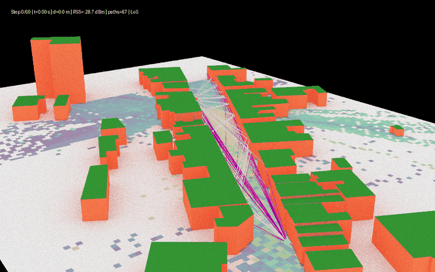
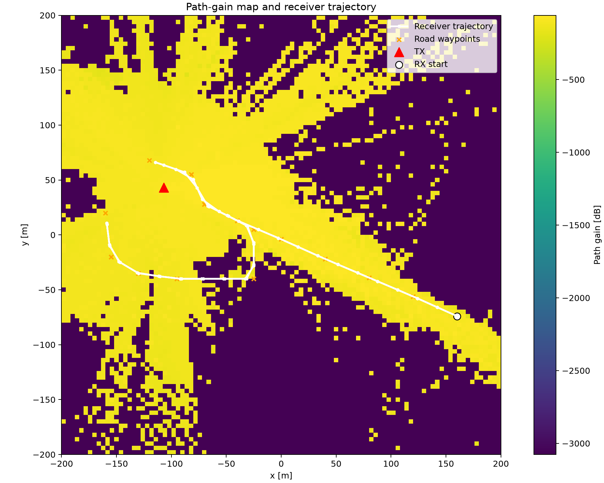
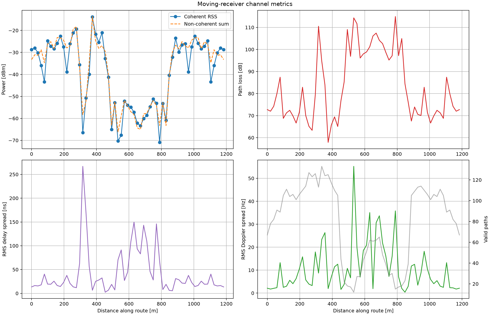
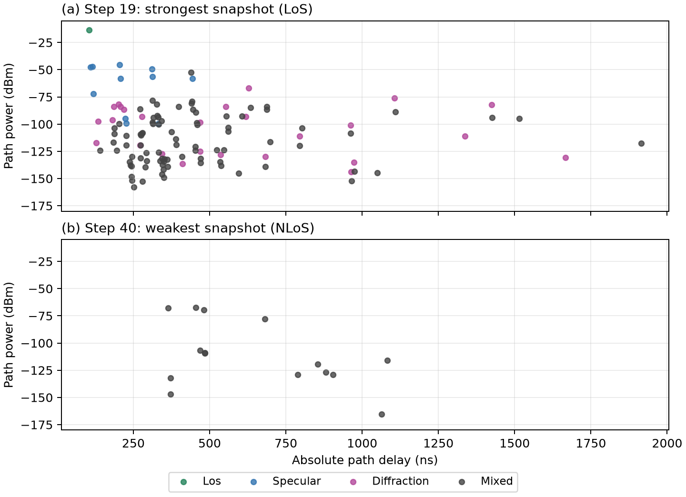

<div align="center">

# SionnaRT Kinematics & ISAC

### Investigation of Sionna RT for Ray-Traced ISAC-Based Sensing

**A 3D ray-tracing study of a mobile receiver, multipath propagation, and channel behavior.**

`3.5 GHz` &nbsp; ? &nbsp; `61 snapshots` &nbsp; ? &nbsp; `4,826 path records` &nbsp; ? &nbsp; `Sionna RT 2.1`

[Explore the notebook](mobility_channel_study.ipynb) ? [Read the report](IEEE_SionnaRT_ISAC_Report.pdf) ? [View the slides](SionnaRT_ISAC_Presentation.pdf) ? [Study documentation](MOBILITY_CHANNEL_STUDY_DOCUMENTATION.md)

</div>

---

## The project at a glance

A fixed transmitter illuminates a 3D environment while a receiver follows a road-aware route. At every sampled position, Sionna RT retraces the propagation paths and records their geometry and channel properties. The resulting data shows how blockage, reflections, diffraction, and path phase affect the moving receiver's channel.

<div align="center">
  
  <br>
  <em>Receiver motion and retraced paths over selected snapshots; the radio map is a static, semi-transparent overlay.</em>
</div>

> **Scope:** This project implements ray tracing and channel analysis. The outputs can support future integrated sensing and communication (ISAC) studies; a sensing waveform, target detector, range?Doppler processor, and sensing accuracy evaluation are not yet implemented.

## What the simulation does

```text
3D scene + radio materials
          ?
Transmitter, receiver, arrays and route
          ?
Static radio map + per-snapshot ray tracing
          ?
Path coefficients, delay, Doppler, angles and geometry
          ?
Channel metrics, datasets, figures and animation
```

- Models line-of-sight (LoS), specular reflection, refraction, diffraction, and mixed paths in a static scene.
- Moves the receiver through a waypoint trajectory and independently retraces its paths at each snapshot.
- Computes coherent and incoherent received power, path counts, delay spread, Doppler spread, and thermal-noise-only SNR.
- Exports results for analysis and documents the experiment in an IEEE-style report and Beamer presentation.

## Results from the saved run

The report and presentation use the balanced run [`mobility_20261104_235027`](outputs/mobility_20261104_235027/).

| Experiment | Result |
| --- | --- |
| Carrier frequency / bandwidth | 3.5 GHz / 20 MHz |
| Receiver route / nominal speed | 1,183.45 m / 10 m/s |
| Snapshots / valid path records | 61 / 4,826 |
| Coherent received power | ?70.92 to ?13.87 dBm |
| LoS / NLoS snapshots | 39 / 22 |
| Snapshots with no valid paths | 0 |

### Route and coverage

<div align="center">
  
  <br>
  <em>The static radio map is evaluated at 1.5 m; the receiver follows the route at 2 m.</em>
</div>

### Channel behavior along the route

<div align="center">
  
  <br>
  <em>Coherent and incoherent power differ because the coherent sum includes interference between path phases.</em>
</div>

### Strongest and weakest snapshots

<div align="center">
  
  <br>
  <em>Each point represents a traced path, with color indicating its interaction category.</em>
</div>

These values describe one simulation, not field measurements or a practical service-outage test. NLoS means the direct path is absent; it does not mean that all paths or a real communication link have failed.

## Project contents

| Path | Description |
| --- | --- |
| [`mobility_channel_study.ipynb`](mobility_channel_study.ipynb) | Main simulation, analysis, exports, plots, and optional animation |
| [`test_scene/`](test_scene/) | Scene definition and 3D geometry |
| [`outputs/mobility_20261104_235027/`](outputs/mobility_20261104_235027/) | Saved run used in the report and presentation |
| [`MOBILITY_CHANNEL_STUDY_DOCUMENTATION.md`](MOBILITY_CHANNEL_STUDY_DOCUMENTATION.md) | Detailed workflow and data dictionaries; its worked results refer to an older run |
| [`IEEE_SionnaRT_ISAC_Report.pdf`](IEEE_SionnaRT_ISAC_Report.pdf) | IEEE-style report; LaTeX source is included alongside it |
| [`SionnaRT_ISAC_Presentation.pdf`](SionnaRT_ISAC_Presentation.pdf) | Beamer presentation; LaTeX source and speaking notes are included |
| [`IEEE_SionnaRT_ISAC_Report_Overleaf.zip`](IEEE_SionnaRT_ISAC_Report_Overleaf.zip), [`SionnaRT_Beamer_Overleaf.zip`](SionnaRT_Beamer_Overleaf.zip) | Self-contained LaTeX packages with figures |
| [`test.ipynb`](test.ipynb), [`test_code.py`](test_code.py) | Earlier single-link scene exploration |

## Setup

The saved run records Python 3.13.0, Sionna 2.1.0, and NumPy 2.4.6. The pinned packages are listed in `requirements.txt`; the simulation also requires a compatible Mitsuba/Dr.Jit backend and a Jupyter frontend. Rendering and ray tracing can be computationally demanding.

From the project root, create a virtual environment and install the dependencies. For example, in PowerShell:

```powershell
python -m venv .venv
.\.venv\Scripts\Activate.ps1
python -m pip install -r requirements.txt
```

Open `mobility_channel_study.ipynb` in a Jupyter-compatible editor and select this environment as its kernel. If your editor does not provide Jupyter and a kernel, install them in the environment:

```powershell
python -m pip install jupyterlab ipykernel
python -m ipykernel install --user --name siona-rt --display-name "Python (Sionna RT)"
jupyter lab
```

## Run the study

1. Open the main notebook from the project root so its relative paths resolve correctly.
2. In the configuration cell, select `RUN_PROFILE = "quick"`, `"balanced"`, or `"publication"`. The quick profile is useful for checking the setup first.
3. For a faster initial run, set `CREATE_SCENE_GIF = False` and, if an interactive viewer is unavailable, `OPEN_INTERACTIVE_PREVIEW = False`.
4. Run the cells in order. The configuration cell creates a timestamped directory under `outputs/`.
5. Inspect that directory's `RUN_SUMMARY.md`, `run_config.json`, and CSV files. Re-running export cells without re-running the configuration cell can overwrite files in the current run directory.

The notebook offers three profiles:

| Profile | Snapshots | Path depth | Path samples per source |
| --- | ---: | ---: | ---: |
| `quick` | 21 | 2 | 20,000 |
| `balanced` | 61 | 3 | 100,000 |
| `publication` | 181 | 5 | 1,000,000 |

A higher profile increases computation and does not by itself establish physical accuracy or solver convergence.

## Output files

Each run may contain:

- `snapshot_summary.csv`: position, path count, received power, delay/Doppler spread, and other snapshot metrics.
- `path_data.csv`: one row per valid path, including coefficients, delays, Doppler, angles, and interaction data.
- `channel_arrays.npz`: padded channel arrays; use the `valid` mask when analyzing them.
- `run_config.json`, `RUN_SUMMARY.md`, and `DATA_DICTIONARY.md`: configuration, overview, and field definitions.
- `figures/`, `scene_frames/`, and a GIF: visualizations when the relevant notebook cells are enabled.

The `.gitignore` keeps the saved run used by the documents available for version control, while excluding its full-size generated GIF and most animation frames, other run directories, and local build/cache files. A smaller GIF preview is included for this README. Ignored files remain on disk; the notebook can regenerate them. The two frames used by the presentation are retained.

## Build the report and presentation

The LaTeX files use the saved run's figures through relative paths, so compile them from the project root. With a TeX distribution containing `IEEEtran` and Beamer:

```powershell
pdflatex IEEE_SionnaRT_ISAC_Report.tex
pdflatex IEEE_SionnaRT_ISAC_Report.tex
pdflatex SionnaRT_ISAC_Presentation.tex
pdflatex SionnaRT_ISAC_Presentation.tex
```

Alternatively, upload `IEEE_SionnaRT_ISAC_Report_Overleaf.zip` or `SionnaRT_Beamer_Overleaf.zip` to Overleaf; each archive includes its required source and figures.

## Interpretation and limitations

- The scene, materials, transmitter, and environment are static; the receiver moves between independently traced snapshots. Path indices should not be assumed to track the same physical path across snapshots.
- The ITU-style materials are not calibrated to measurements. Although diffuse reflection is enabled, the saved materials have zero scattering coefficients.
- Coherent RSS is a narrowband, reference-frequency calculation. The reported SNR uses thermal noise only and does not include interference or receiver noise figure.
- Receiver velocity is estimated from chords between sampled points. At sharp turns this can underestimate the nominal speed and affect Doppler.
- The radio map is computed at 1.5 m while the receiver is at 2 m; a map cell is not the same quantity as the snapshot's coherent RSS.
- A missing direct path does not imply service outage. The current model does not define a receiver sensitivity or SNR threshold.

## Team

- Nandish Chauhan — 202451040@iiitvadodara.ac.in
- Aahan Poddar — 202451184@iiitvadodara.ac.in

Under the guidance of Dr. Bhupendra Kumar — bhupendra_kumar@iiitvadodara.ac.in.
